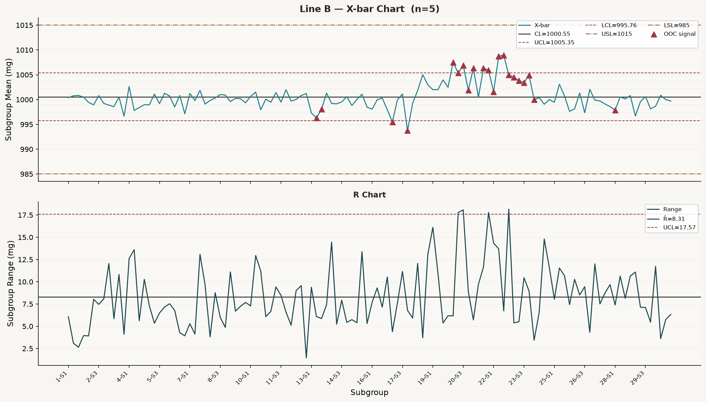
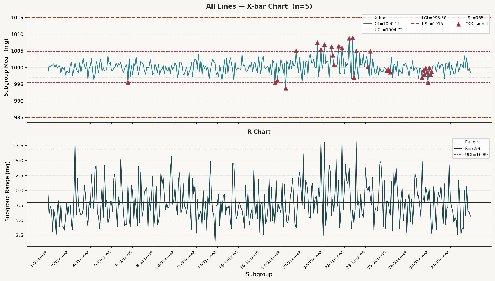
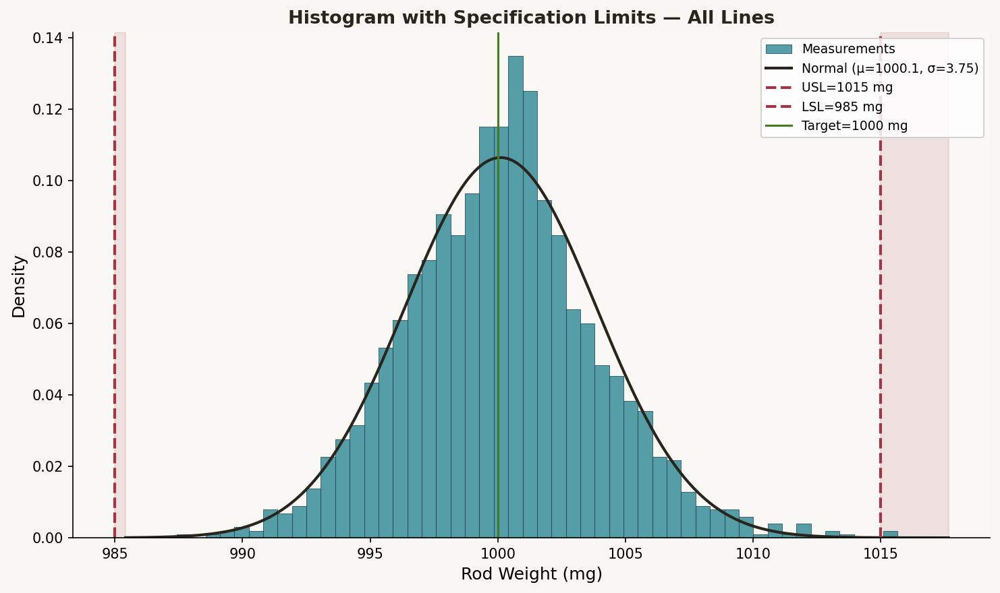
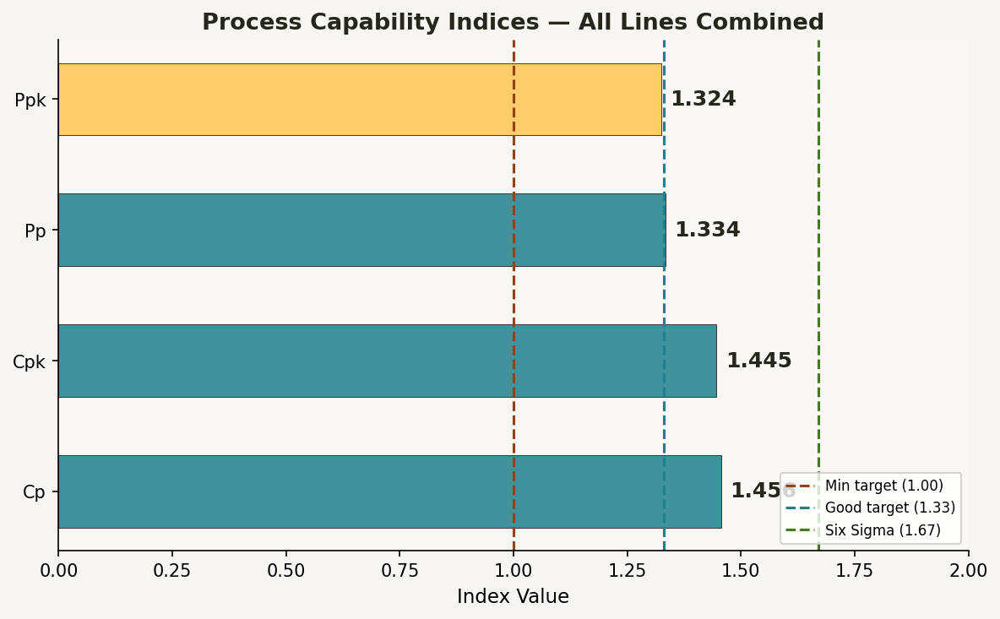
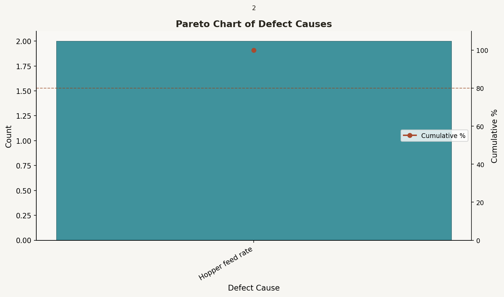

# Process Control & SPC Toolkit

[](https://python.org)
[](tests/)
[](https://asq.org/cert/six-sigma-green-belt)
[](https://www.aiag.org)
[](LICENSE)

A pure-Python **Statistical Process Control (SPC) toolkit** built around a simulated tobacco rod weight dataset — modeled on the manufacturing context at **Philip Morris International (PMI)**.

The project demonstrates the full Six Sigma DMAIC measurement and analysis workflow: synthetic factory data generation, X-bar & R control charts with proper AIAG/Montgomery constants, Western Electric out-of-control rules, process capability analysis (Cp/Cpk/Pp/Ppk), Pareto of defect causes, and an auto-generated control-plan report.

---

## Why This Exists

This toolkit was built to bridge **process quality engineering** and **data science**:

- **PMI Quality Assurance Engineer context**: Tobacco rod fill weight (target 1000 mg ±15 mg) is a critical quality characteristic in cigarette manufacturing. Monitoring it with X-bar & R charts and capability analysis maps directly to the measurement systems and reporting used in PMI's production environment.
- **ASQ Six Sigma Green Belt path**: I'm pursuing CSSGB certification through the **Syracuse University Onward to Opportunity (O2O)** program. Every module here — control chart construction, WECO rules, capability indices, Pareto analysis — aligns with the ASQ CSSGB Body of Knowledge (Section III: Measure, Section V: Control).
- **Recruiter signal**: This is a working, tested codebase — not a notebook. Production-quality structure with unit tests, typed functions, docstrings, and AIAG-aligned math.

---

## Charts

### X-bar Chart — Line B (Quality Event Visible)

The deliberate out-of-control event on Line B (days 18–22) is clearly visible. Red triangles mark Western Electric rule violations. The process recovers after corrective action on day 23.



### X-bar & R Chart — All Lines Combined



### Histogram with Specification Limits

Normal distribution overlay with USL=1015 mg and LSL=985 mg shaded rejection zones.



### Process Capability Gauge



### Pareto Chart of Defect Causes



---

## Process Capability Results

Computed from 1,800 observations (30 days × 4 shifts × 3 lines × 5 samples/shift). SPC constants for n=5: **A2=0.577, D3=0, D4=2.114, d2=2.326** (Montgomery, *Introduction to Statistical Quality Control*, 8th ed., Table VI).

**Formulas:**
```
Cp  = (USL − LSL) / (6 × σ_within)      where σ_within = R̄ / d2
Cpk = min((USL − mean) / (3 × σ_within),  (mean − LSL) / (3 × σ_within))
Pp  = (USL − LSL) / (6 × σ_overall)      where σ_overall = s (sample std dev)
Ppk = min((USL − mean) / (3 × σ_overall), (mean − LSL) / (3 × σ_overall))
```

### All Lines Combined

| Index | Value  | Interpretation                        |
|-------|--------|---------------------------------------|
| Cp    | 1.4559 | Good potential capability (> 1.33)    |
| **Cpk**   | **1.4453** | **Full-period short-term index, including the simulated shift**      |
| Pp    | 1.3338 | Long-term performance acceptable      |
| Ppk   | 1.3241 | Below the 1.33 comparison threshold      |
| σ level | 4.34σ | Above 4σ threshold                  |

### By Machine Line

| Line    | Cp     | Cpk    | Pp     | Ppk    | Mean (mg) | σ_within |
|---------|--------|--------|--------|--------|-----------|----------|
| Line A  | 1.4984 | 1.4951 | 1.4168 | 1.4137 | 999.97    | 3.337    |
| **Line B**  | **1.3992** | **1.3477** | **1.2069** | **1.1625** | **1000.55**   | **3.573**    |
| Line C  | 1.4738 | 1.4547 | 1.4268 | 1.4084 | 999.81    | 3.393    |

> **Note:** Line B shows the lowest Cpk (1.35) due to the deliberate mean shift during days 18–22. Pp/Ppk are notably lower than Cp/Cpk on Line B, reflecting elevated long-term variation — exactly the gap a quality engineer investigates.

---

## Western Electric Rules Implemented

The WECO rules detect non-random patterns in control charts beyond simple 3σ exceedances. The four classic Western Electric rules and four additional run-pattern rules are implemented in [`src/rules.py`](src/rules.py).

| Rule | Trigger                                        | Purpose                            |
|------|------------------------------------------------|------------------------------------|
| **1** | 1 point beyond ±3σ (Zone A)                  | Obvious out-of-control             |
| **2** | 2 of 3 consecutive points beyond ±2σ, same side | Sustained shift detection        |
| **3** | 4 of 5 consecutive points beyond ±1σ, same side | Gradual drift detection          |
| **4** | 8 consecutive points same side of centerline  | Persistent centering shift         |
| **5** | 6 consecutive points trending up or down      | Systematic trend / tool wear       |
| 6    | 15 consecutive points within ±1σ             | Stratification / subgroup mixing   |
| 7    | 14 consecutive points alternating up-down     | Over-control / tampering           |
| 8    | 8 consecutive points beyond ±1σ, both sides  | Mixture — two process distributions|

Rules 1–5 are applied by default in the report. All eight are unit tested.

In production order the combined chart records **35 rule hits across 32 distinct subgroups**. On the separate Line B chart, **11 of 20 subgroups** trigger at least one rule during the simulated drift on days 18–22. Multiple rules can flag the same subgroup. The capability figures above summarize the whole simulation, including its unstable period.

---

## Project Structure

```
process-control-spc/
├── src/
│   ├── __init__.py
│   ├── generate_factory_data.py   # Seeded synthetic factory data (1800 obs)
│   ├── spc_charts.py              # X-bar, R, run charts with UCL/LCL
│   ├── capability.py              # Cp, Cpk, Pp, Ppk calculations
│   ├── rules.py                   # Western Electric rules 1–8
│   └── report.py                  # End-to-end runner → charts + report
├── tests/
│   ├── test_capability.py         # Capability calculations
│   ├── test_rules.py              # Rule and constant tests
│   └── test_chart_sequence.py     # Time order and subgroup-size checks
├── data/
│   └── factory_measurements.csv  # Generated CSV (600 obs × 3 lines)
├── reports/
│   ├── control_plan_report.txt    # Control-plan-style summary
│   └── charts/                    # All chart PNGs
│       ├── xbar_r_overall.png
│       ├── xbar_r_line_a.png
│       ├── xbar_r_line_b.png      ← quality event visible here
│       ├── xbar_r_line_c.png
│       ├── histogram_spec_limits.png
│       ├── capability_gauge.png
│       ├── pareto_defect_causes.png
│       └── run_chart.png
├── requirements.txt
├── .gitignore
├── LICENSE
└── README.md
```

---

## How to Run

### 1. Clone and install

```bash
git clone https://github.com/Gavand1969/process-control-spc.git
cd process-control-spc
pip install -r requirements.txt
```

### 2. Generate data

```bash
python src/generate_factory_data.py
```

Creates `data/factory_measurements.csv` with 1,800 rows.

### 3. Run the full report

```bash
python src/report.py
```

Produces all charts in `reports/charts/` and a text control plan summary in `reports/control_plan_report.txt`.

Force-regenerate data:
```bash
python src/report.py --regen
```

### 4. Run unit tests

```bash
python -m pytest tests/ -v
```

All 55 tests pass. Tests verify:
- SPC constants A2=0.577, D3=0, D4=2.114, d2=2.326 for n=5
- Cpk formula correctness against hand-calculated values
- Each Western Electric rule triggers and does not trigger on synthetic edge cases

---

## Plug In Your Own Data

The toolkit accepts any CSV with measurement data. Match this column schema (or adapt `build_control_chart()` in `spc_charts.py`):

| Column         | Type    | Description                                      |
|----------------|---------|--------------------------------------------------|
| `sample_id`    | int     | Unique observation ID                             |
| `day`          | int     | Production day                                    |
| `shift`        | int     | Shift number within day (1–4)                     |
| `machine_line` | str     | Machine/line identifier                           |
| `weight_mg`    | float   | Measured characteristic (or rename in call)       |
| `out_of_spec`  | bool    | Pre-computed or set to `None` (report computes)   |

```python
import pandas as pd
from src.capability import compute_capability
from src.spc_charts import build_control_chart, plot_xbar_r

df = pd.read_csv("your_data.csv")
df = df.sort_values(["day", "shift", "machine_line", "sample_id"])
df["subgroup_id"] = df.groupby(["day", "shift", "machine_line"], sort=False).ngroup()

chart = build_control_chart(df, value_col="weight_mg", group_col="subgroup_id", n=5)
fig = plot_xbar_r(chart, title_prefix="My Process", usl=1015, lsl=985)

cap = compute_capability(df["weight_mg"].values, usl=1015, lsl=985, subgroup_size=5)
print(f"Cpk = {cap.cpk:.4f}")
```

---

## What This Demonstrates

| Competency | Implementation |
|---|---|
| **SPC chart construction** | X-bar & R with AIAG-correct A2/D3/D4/d2 constants |
| **Out-of-control detection** | Four Western Electric rules and four additional run-pattern checks, unit tested |
| **Process capability** | Cp, Cpk (short-term), Pp, Ppk (long-term) with proper σ_within vs σ_overall |
| **Root cause analysis** | Pareto chart of defect causes with 80% line |
| **Quality event storytelling** | Line B drift Days 18–22, corrective action Day 23 |
| **Control plan thinking** | Auto-generated control plan summary with recommendations |
| **Software engineering** | Pure Python, typed functions, docstrings, 55 automated tests |
| **Standards alignment** | AIAG SPC Manual 2nd ed., Montgomery SQC 8th ed., ASQ CSSGB BoK |

---

## ASQ Six Sigma Green Belt

I am actively pursuing the **ASQ Certified Six Sigma Green Belt (CSSGB)** through the **Syracuse University Onward to Opportunity (O2O)** program. This project directly maps to the ASQ CSSGB Body of Knowledge:

- **Section III (Measure):** Process capability (Cp, Cpk), measurement systems, data collection
- **Section IV (Analyze):** Control charts, process variation, root cause analysis (Pareto, fishbone)
- **Section V (Control):** Control plans, SPC implementation, out-of-control response

The SPC constants used here (A2, D3, D4, d2) are sourced from Montgomery's *Introduction to Statistical Quality Control* — the same reference text used in ASQ certification preparation.

---

## References

- Montgomery, D.C. (2020). *Introduction to Statistical Quality Control*, 8th ed. Wiley.
- AIAG (2005). *Statistical Process Control (SPC) Reference Manual*, 2nd ed.
- Western Electric Company (1956). *Statistical Quality Control Handbook*.
- ASQ. [Certified Six Sigma Green Belt Body of Knowledge](https://asq.org/cert/six-sigma-green-belt).

---

*Gavin Anderson · M.S. Data Science · ASQ CSSGB Candidate (Syracuse O2O)*
